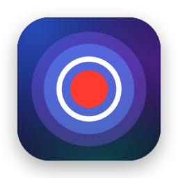
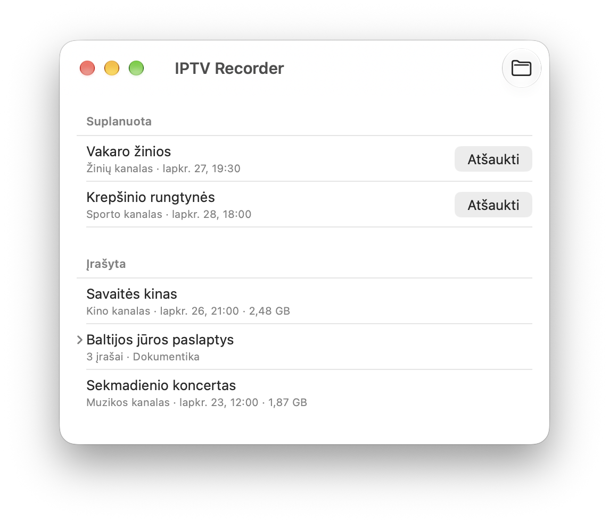

<h1 align="center">IPTV Recorder</h1>

Mac'o programa, kuri įrašo kanalus, užsakytus Apple TV programos <b>IPTV</b>, ir saugo įrašus šiame Mac'e. Apple TV ją randa namų tinkle pati.

## Ką ji daro

- **Įrašo** dabar rodomą laidą, būsimą laidą iš TV programos arba visas laidos serijas.
- **Pasiima iš archyvo** laidą, kurios nepavyko įrašyti (Mac'as miegojo, kanalas neatsiliepė), ir jau praėjusią laidą, jei kanalas turi archyvą.
- **Pratęsia** vykstantį įrašą +30 min, kai laida ar rungtynės užsitęsia.
- **Rodo įrašus** abiejuose Apple TV: kur sustojote viename, kitas tęsia nuo ten pat.
- **Telefone** – QR kodas iš TV atidaro įrašą: žiūrėti, **Bendrinti** (visas iPhone bendrinimo langas) ir atsisiųsti.
- **Tvarkosi pati**: peržiūrėti įrašai gali keliauti į šiukšlinę po dienos, savaitės ar mėnesio, nepavykę dingsta po 2 dienų, trūkstant vietos – perspėja.
- **Mac'o lange** – įrašų sąrašas, serijos kaip aplankai; dukart spustelėjus įrašas atsidaro, dešiniu pelės mygtuku – „Rodyti Finder'yje“, „Į telefoną…“, „Perkelti į šiukšlinę“.
- **Atsinaujina pati** – programos meniu „Tikrinti atnaujinimus…“.

## Diegimas

| Failas | Kam |
|---|---|
| `IPTV-Recorder-<versija>-arm.dmg` | Mac'ams su Apple procesoriumi (M1 ir naujesniais), naujausia macOS |
| `IPTV-Recorder-<versija>-intel.dmg` | Intel Mac'ams nuo macOS 14 Sonoma |

1. Atsisiųskite naujausią leidimą iš [Releases](https://github.com/iSaulius/iptv-recorder-releases/releases/latest), atidarykite .dmg ir nutempkite **IPTV Recorder** į **Programos**.
2. Pirmą kartą macOS programą sustabdys (ji pasirašyta be Apple kūrėjo narystės): **Sistemos nustatymai → Privatumas ir saugumas → „Vis tiek atidaryti“**.
3. Programa atsiranda meniu juostoje ir pasileidžia kartu su Mac'u. Apple TV ją randa pati: **Nustatymai → Bendrieji → Įrašai → Įrašymo Mac'as**.

Telefono „Bendrinti“ pirmą kartą paprašys pasitikėti šiuo Mac'u – puslapis pats parodys tris žingsnius.

## Reikalavimai

- Mac'as ir Apple TV tame pačiame namų tinkle; Apple TV programa IPTV 0.110 ar naujesnė (kol kas viešai neplatinama).
- Įrašymo metu Mac'as turi būti įjungtas (MacBook – atidarytu dangčiu). 12 valandų prieš suplanuotą įrašą programa neleidžia jam užmigti; užmigusio pažadinti negali.

## Privatumas

Kanalų adresai lieka tik šiame Mac'e ir niekur nesiunčiami. Programa atsako tik namų tinklo įrenginiams, įrašai lieka Mac'e.

Čia – tik paruošti programos failai; jos kodas laikomas atskirai.

---

© 2026 iSaulius · Nemokama asmeniniam naudojimui · [Licencija](LICENSE)
